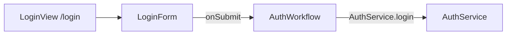
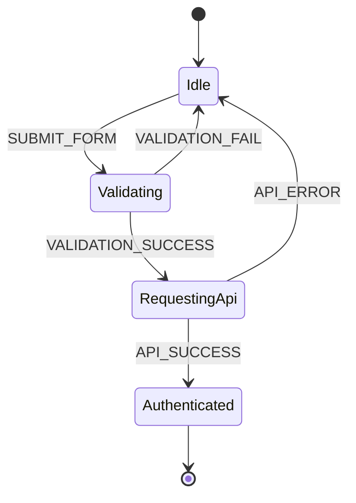

# FAPL: Frontend Architecture & Process Language

*[FAPL]: Frontend Architecture & Process Language
*[SCXML]: State Chart XML
*[FSD]: Feature-Sliced Design
*[RPC]: Remote Procedure Call
*[BPMN]: Business Process Model and Notation
*[DSL]: Domain-Specific Language

**FAPL** (Frontend Architecture & Process Language) — декларативный метаязык, на котором фронтенд-модуль описывают тремя слоями: компоненты, бизнес-процессы и контракты сервисов. Текст читается сверху вниз как техническое задание, а жёсткая схема даёт ИИ-агенту однозначный вход для генерации кода.

Готового коробочного стандарта с именем FAPL в индустрии нет. Каркас собран из практик, которые уже применяют, когда логику нужно отдать агенту без двусмысленности: конечные автоматы [SCXML](https://www.w3.org/TR/scxml/) и [XState](https://stately.ai/docs), декларативные компоненты и RPC-контракт в духе [OpenAPI](https://www.openapis.org/).

Нормативные правила, поля и JSON Schema — в [спецификации FAPL 1.0](specification.md).

## Три слоя {#layers}

<div class="grid cards" markdown>

- :material-view-dashboard-outline:{ .lg .middle } **components**

    ***

    Страницы и компоненты: маршрут, дети, входы и выходы. Разметка понятна человеку и не называет фреймворк.

- :material-state-machine:{ .lg .middle } **workflows**

    ***

    Бизнес-процесс как конечный автомат: начальное состояние, события, переходы, действия на входе и на ребре.

- :material-api:{ .lg .middle } **services**

    ***

    Интеграции: метод, параметры, успешный ответ и ошибка. Этого достаточно, чтобы сгенерировать типы и функцию вызова.

</div>

## Из чего собран язык {#sources}

| Слой | На что опирается | Что забирает агент |
| --- | --- | --- |
| `workflows` | [SCXML](https://www.w3.org/TR/scxml/), [XState](https://stately.ai/docs) | Какое событие из какого состояния куда ведёт |
| `components` | [Web Components](https://developer.mozilla.org/docs/Web/API/Web_components), Container/Component | Что на экране, какие данные входят и какое действие выходит |
| `services` | RPC, [OpenAPI](https://www.openapis.org/) | Сигнатуру вызова, форму успеха и форму ошибки |

### Процессы

Слой `workflows` повторяет модель состояний и переходов SCXML и конфигурацию библиотек вроде XState. У события есть целевое состояние. Агент видит, что `VALIDATION_SUCCESS` переводит процесс из `Validating` в `RequestingApi`, и у этого ребра нет второго прочтения.

### Компоненты

Слой `components` — короткая декларация: страница или компонент, входы, выходы, дочерние элементы. Она близка к разметке Web Components и к разделению Container/Component (smart/dumb): страница держит маршрут и собирает детей, компонент объявляет данные и действие наружу.

### Сервисы

Слой `services` описывает вызов так, как фронтенду нужен контракт, а не вся спецификация бэкенда: имя метода, признак асинхронности, параметры, результат и ошибка.

## Готовые аналоги {#analogs}

Ту же постановку закрывают два существующих инструмента: XState для процесса и Feature-Sliced Design для раскладки кода.

### XState

[XState](https://stately.ai/docs) описывает фронтенд-логику конечным автоматом: объектом JavaScript или JSON. Человек задаёт процесс, агент собирает по нему код поведения интерфейса. В публичном разборе этого приёма фигурируют GPT-4o и Claude 3.5 Sonnet: на конфигурациях XState они обучены плотно. Более новые агенты читают тот же объект как обычный код.

### Feature-Sliced Design

[Feature-Sliced Design](https://feature-sliced.design/) — методология раскладки кода на `shared`, `entities`, `features` и `pages`, а не язык. В задании достаточно фразы: «Реализуй модуль в архитектуре FSD, где фича Х имеет стейт-машину Y». Спецификация FSD открыта, и в обучающих корпусах она встречается вместе с рабочими репозиториями.

!!! tip "Формулировка без парсера FAPL"

    Реализуй модуль в архитектуре FSD. Поведение фичи опиши машиной XState. Файл FAPL имеет смысл, когда экран, процесс и контракт сервиса должны лежать в одном документе и проверяться одной схемой.

Дерево ниже показывает, как пример входа ложится на слои FSD. Это иллюстрация методологии, синтаксис FAPL тут ни при чём.

```text
src/
├── pages/login/        LoginView, маршрут /login
├── features/auth/      LoginForm и AuthWorkflow
├── entities/user/      пользователь из ответа login
└── shared/
```

## Architecture as Code {#aac}

Носитель задачи — Architecture as Code: декларативное описание в YAML. Чтобы текст оставался читаемым для человека и однозначным для агента, он опирается на уровни Containers и Components [модели C4](https://c4model.com/) и на процессы в духе BPMN и конечных автоматов. Агент устойчиво следует жёсткой схеме ([JSON Schema](https://json-schema.org/)), человек читает структурированный текст.

Версия 1.0 фиксирует носитель YAML. Тот же граф можно вести TypeScript-описанием, если форму документа должен проверять редактор. Отдельный TypeScript DSL в эту версию не входит.

## Пример: модуль аутентификации {#example}

Файл [`auth-module.fapl.yaml`](examples/auth-module.fapl.yaml) — канонический пример языка. В `description` названы регистрация и вход; автомат ниже раскладывает сценарий входа.

!!! warning "Ключ on"

    В YAML 1.1 слова `on`, `off`, `yes` и `no` читаются как булевы значения. Ключ карты событий записан в кавычках: `"on"`. Так файл одинаково разбирают парсеры 1.1 и 1.2.

```yaml title="auth-module.fapl.yaml"
--8<-- "docs/fapl/examples/auth-module.fapl.yaml"
```

### Компоненты

`LoginView` — страница с маршрутом `/login`. Её ребёнок — `LoginForm`. У формы один вход, `defaultEmail` типа `String`, и один выход `onSubmit`. Выход ссылается на `AuthWorkflow.startLogin`. Это символ привязки выхода к процессу. Событие, которое уводит автомат из `Idle`, называется `SUBMIT_FORM`: имена привязки и события в каркасе 1.0 могут различаться. Генератору нужна явная договорённость, какое событие шлёт `onSubmit`; в этом примере им считается `SUBMIT_FORM`.



### Процесс

`AuthWorkflow` начинается в `Idle`.

| Событие | Из | В | Что ещё происходит |
| --- | --- | --- | --- |
| `SUBMIT_FORM` | `Idle` | `Validating` | Полезная нагрузка: `email`, `pass` |
| `VALIDATION_SUCCESS` | `Validating` | `RequestingApi` | На входе в `Validating` уже выполнен `executeValidation` |
| `VALIDATION_FAIL` | `Validating` | `Idle` | Действие `showValidationError` |
| `API_SUCCESS` | `RequestingApi` | `Authenticated` | `saveToken`, затем `redirectToDashboard` |
| `API_ERROR` | `RequestingApi` | `Idle` | `showApiError` |

На входе в `RequestingApi` вызывается `AuthService.login`. Состояние `Authenticated` помечено `type: Final`: исходящих переходов у него нет.



Фрагмент того же ребра на двух носителях. Блок XState — та же развилка в конфигурации библиотеки: агент читает её как обычный код машины.

=== "FAPL"

    ```yaml
    Validating:
      entry: executeValidation
      "on":
        VALIDATION_SUCCESS:
          target: RequestingApi
        VALIDATION_FAIL:
          target: Idle
          action: showValidationError
    ```

=== "XState"

    ```ts
    Validating: {
      entry: 'executeValidation',
      on: {
        VALIDATION_SUCCESS: { target: 'RequestingApi' },
        VALIDATION_FAIL: {
          target: 'Idle',
          actions: 'showValidationError',
        },
      },
    },
    ```

Машина целиком, в API XState 5. Полезная нагрузка `SUBMIT_FORM` в FAPL лежит в `payload`; здесь она остаётся данными события. `entry: 'login'` соответствует вызову `AuthService.login`, а исход вызова приходит событиями `API_SUCCESS` и `API_ERROR`.

```ts title="auth-workflow.ts"
import { setup } from 'xstate';

export const authWorkflow = setup({
  actions: {
    executeValidation: () => {},
    showValidationError: () => {},
    login: () => {},
    saveToken: () => {},
    redirectToDashboard: () => {},
    showApiError: () => {},
  },
}).createMachine({
  id: 'AuthWorkflow',
  initial: 'Idle',
  states: {
    Idle: {
      on: {
        SUBMIT_FORM: { target: 'Validating' },
      },
    },
    Validating: {
      entry: 'executeValidation',
      on: {
        VALIDATION_SUCCESS: { target: 'RequestingApi' },
        VALIDATION_FAIL: {
          target: 'Idle',
          actions: 'showValidationError',
        },
      },
    },
    RequestingApi: {
      entry: 'login',
      on: {
        API_SUCCESS: {
          target: 'Authenticated',
          actions: ['saveToken', 'redirectToDashboard'],
        },
        API_ERROR: {
          target: 'Idle',
          actions: 'showApiError',
        },
      },
    },
    Authenticated: { type: 'final' },
  },
});
```

### Сервисы

`AuthService.login` объявлен с `async: true`. Параметры — `email` и `pass` типа `String`. Успешный ответ — `token` типа `String` и объект `user` с полями `id` типа `ID` и `name` типа `String`. Ошибка — объект с полями `code` и `message` типа `String`.

## Почему формат читают оба {#why}

### Человек

- Документ идёт в порядке технического задания: что это за модуль, из чего экран, какой сценарий, какой вызов.
- Зона ответственности видна по ключу верхнего уровня.
- В файле зафиксирована бизнес-логика. Выбор React, Vue или Angular остаётся за генерацией.

### ИИ-агент

- Автомат не оставляет развилки «что автор имел в виду на этом переходе».
- Поля `inputs`, `outputs`, `params`, `returns` и `error` задают форму данных для интерфейсов TypeScript и для проверок.
- Схему [`fapl-1.0.schema.json`](examples/fapl-1.0.schema.json) агент может применить до генерации кода и поймать ошибку документа, пока ещё не написан компонент.

## Как запустить это сейчас {#start}

Первый прогон собирается из уже существующих инструментов.

- **Процессы.** Конфигурация [XState](https://stately.ai/docs), объектом или JSON. По такой схеме агент собирает код поведения интерфейса.
- **Архитектура.** [Structurizr DSL](https://docs.structurizr.com/dsl/language) или диаграммы [Mermaid](https://mermaid.js.org/syntax/stateDiagram.html) (`stateDiagram`, `classDiagram`). Mermaid остаётся текстом для агента и рисунком для человека в Markdown, в том числе на GitHub.
- **Проверка файла.** Схема [`fapl-1.0.schema.json`](examples/fapl-1.0.schema.json) и правила [спецификации](specification.md).

### Черновик инструкции агенту {#agent-prompt}

Текст ниже удерживает генерацию внутри файла модуля. Стек проекта в инструкцию не вшит: хуки React, стор Vue или другой рантайм дописывают отдельным абзацем.

```text title="fapl-agent.txt"
Ты генерируешь клиентский код по модулю FAPL 1.0 (YAML).

Правила:
- Источник истины — файл модуля. Слои: components, workflows, services.
- components задают страницы и компоненты: type, route, children, inputs, outputs.
- workflows — конечный автомат. Событие из ключа "on" переводит состояние только в указанный target. entry выполняется при входе в состояние. action выполняется на переходе.
- Состояние с type: Final не содержит on и entry.
- services задают методы. params, returns и error — типы аргументов, успеха и ошибки. async: true означает асинхронный вызов.
- Скалярные типы версии 1.0: String и ID. Объект задаёт вложенную структуру.
- Ссылка с точкой — Service.method или Workflow.symbol. Имя без точки — локальное действие модуля.
- Символ в outputs.action (например AuthWorkflow.startLogin) — привязка выхода к процессу. Имя события внутри автомата может с ним не совпадать. Если в задании нет явного соответствия, для модуля Authentication считай, что onSubmit шлёт SUBMIT_FORM.
- Не добавляй состояния, события, методы и поля, которых нет в модуле.
- Перед генерацией проверь документ по JSON Schema FAPL 1.0. Если документ невалиден, остановись и перечисли ошибки.
- Стек реализации бери из отдельной инструкции к проекту. Имена сущностей сохраняй как в модуле.
```

## Куда растёт формат {#next}

Версия 1.0 держит поведение в автомате. То, как генератор раскладывает его по хукам React или по стору Vue, задаётся приложением к спецификации под конкретный стек, отдельными полями внутри модуля это не смешивается.

Дальше — [спецификация FAPL 1.0](specification.md).
