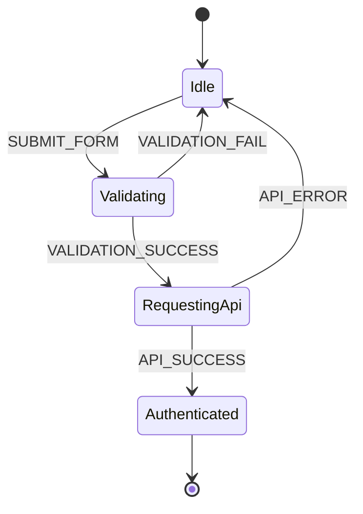
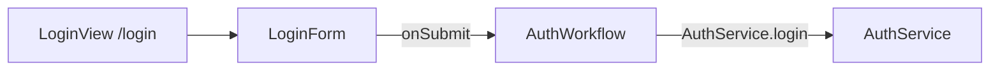

# Спецификация FAPL 1.0

*[FAPL]: Frontend Architecture & Process Language
*[YAML]: YAML Ain't Markup Language
*[RPC]: Remote Procedure Call

Эта страница задаёт каркас **FAPL 1.0** (Frontend Architecture & Process Language): какие поля есть у модуля, как устроены три слоя и какой документ считается согласованным. Зачем язык собран именно так и как его читать агенту, написано в [обзоре](index.md).

!!! abstract "Статус"

    Версия **1.0** — каркас. Он фиксирует форму документа, три слоя и пример модуля аутентификации. Парсер, рантайм и привязка к React, Vue или Angular в эту версию не входят.

## Файл {#file}

| Правило | Значение |
| --- | --- |
| Кодировка | UTF-8 |
| Расширение | `.fapl.yaml` |
| Синтаксис | YAML |
| Версия YAML | 1.2. Ключ карты событий пишется как `"on"`, чтобы парсер YAML 1.1 не превратил его в булево значение |
| Комментарии | Строки, начинающиеся с `#`, смысла для языка не несут |

Корень файла — одно отображение. Порядок ключей в тексте: `version`, `module`, `description`, `components`, `workflows`, `services`. Порядок для машины не значим; для человека он совпадает с порядком чтения технического задания.

Идентификатор — непустая строка из латиницы, цифр и `_`, первый символ не цифра: `^[A-Za-z_][A-Za-z0-9_]*$`.

## Документ модуля {#document}

| Поле | Обязательность | Форма |
| --- | --- | --- |
| `version` | обязан присутствовать | Строка `"1.0"` |
| `module` | обязан присутствовать | Непустая строка, имя модуля |
| `description` | может отсутствовать | Строка для человека |
| `components` | обязан присутствовать | Список компонентов, возможно пустой |
| `workflows` | обязан присутствовать | Отображение «имя процесса → процесс», хотя бы один процесс |
| `services` | обязан присутствовать | Отображение «имя сервиса → сервис», список может быть пустым |

Имена процессов — ключи `workflows`. Имена сервисов — ключи `services`. Оба набора подчиняются правилу идентификатора.

## Компоненты {#components}

Элемент списка `components` описывает страницу или компонент интерфейса.

| Поле | Обязательность | Форма |
| --- | --- | --- |
| `name` | обязан присутствовать | Идентификатор, уникальный среди компонентов модуля |
| `type` | обязан присутствовать | `Page` или `Component` |
| `route` | обязан у `Page`, у `Component` отсутствует | Строка маршрута, начинается с `/` |
| `children` | может отсутствовать | Непустой список имён компонентов того же модуля |
| `inputs` | может отсутствовать | Непустой список входов |
| `outputs` | может отсутствовать | Непустой список выходов |

Вход:

| Поле | Обязательность | Форма |
| --- | --- | --- |
| `name` | обязан присутствовать | Идентификатор, уникальный среди входов этого компонента |
| `type` | обязан присутствовать | [Выражение типа](#types) |

Выход:

| Поле | Обязательность | Форма |
| --- | --- | --- |
| `name` | обязан присутствовать | Идентификатор, уникальный среди выходов этого компонента |
| `action` | обязан присутствовать | [Действие](#refs) |

`Page` — экран с маршрутом. `Component` — вложенная часть экрана. Имя из `children` указывает на другой элемент того же списка `components`.

В примере `LoginView` — страница `/login`, её ребёнок — `LoginForm`. Выход формы `onSubmit` связан с процессом строкой `AuthWorkflow.startLogin`.

## Процессы {#workflows}

Процесс — конечный автомат.

| Поле | Обязательность | Форма |
| --- | --- | --- |
| `description` | может отсутствовать | Строка |
| `initial_state` | обязан присутствовать | Имя состояния из `states` этого процесса |
| `states` | обязан присутствовать | Отображение «имя состояния → состояние», хотя бы одно |

Состояние:

| Поле | Обязательность | Форма |
| --- | --- | --- |
| `type` | обязан у конечного состояния | Единственное допустимое значение — `Final` |
| `entry` | может быть у неконечного состояния | Одна [ссылка](#refs). Выполняется при входе в состояние |
| `on` | обязан у неконечного состояния | Отображение «имя события → переход» |

Конечное состояние содержит только `type: Final`. Ключей `on` и `entry` у него нет.

У состояния есть либо `type: Final`, либо непустая карта `on`.

Переход:

| Поле | Обязательность | Форма |
| --- | --- | --- |
| `target` | обязан присутствовать | Имя состояния того же процесса |
| `payload` | может отсутствовать | Выражение типа полезной нагрузки события |
| `action` | может отсутствовать | Действие, выполняется вместе с переходом |

Имя события уникально в карте `on` своего состояния. Одинаковое имя события в разных состояниях — разные переходы.

Порядок для одного события такой: при входе в исходное состояние выполняется его `entry`, если он есть; когда приходит событие, выполняется `action` перехода и процесс оказывается в `target`.

В примере `AuthWorkflow` стартует в `Idle`. Событие `SUBMIT_FORM` несёт `email` и `pass` и ведёт в `Validating`. На входе в `Validating` вызывается локальное действие `executeValidation`. На входе в `RequestingApi` вызывается `AuthService.login`.



## Сервисы {#services}

Сервис — набор методов, к которым обращается фронтенд.

| Поле | Обязательность | Форма |
| --- | --- | --- |
| `methods` | обязан присутствовать | Непустой список методов |

Метод:

| Поле | Обязательность | Форма |
| --- | --- | --- |
| `name` | обязан присутствовать | Идентификатор, уникальный среди методов этого сервиса |
| `async` | может отсутствовать | Булево. Отсутствие поля означает синхронный метод. `true` — вызов асинхронный |
| `params` | обязан присутствовать | Выражение типа аргументов |
| `returns` | обязан присутствовать | Выражение типа успешного результата |
| `error` | может отсутствовать | Выражение типа ошибки |

`AuthService.login` в примере асинхронный. Аргументы — `email` и `pass`. Успех — `token` и вложенный `user`. Ошибка — `code` и `message`.

## Типы {#types}

Выражение типа — либо скаляр, либо отображение «поле → выражение типа».

Скаляры версии 1.0:

| Имя | Смысл |
| --- | --- |
| `String` | Строка |
| `ID` | Идентификатор сущности |

Других скаляров в 1.0 нет. Вложенность объектов не ограничена. Имена полей — идентификаторы.

```yaml
returns: { token: String, user: { id: ID, name: String } }
```

Здесь `token` и `name` — строки, `user` — объект, `id` — идентификатор.

## Ссылки и действия {#refs}

Ссылка — идентификатор либо два идентификатора через точку.

| Запись | Куда указывает |
| --- | --- |
| `executeValidation` | Локальное действие модуля. Отдельного реестра таких имён в 1.0 нет: имя само является объявлением |
| `AuthService.login` | Метод `login` сервиса `AuthService`. Оба имени обязаны существовать |
| `AuthWorkflow.startLogin` | Символ процесса `AuthWorkflow`. Процесс обязан существовать. Символ после точки может не совпадать с именем события |

Действие — одна ссылка или непустой список ссылок. Список выполняется в порядке записи. В примере переход `API_SUCCESS` выполняет `saveToken`, затем `redirectToDashboard`.

!!! warning "Привязка выхода и имя события"

    В каноническом примере выход `onSubmit` ссылается на `AuthWorkflow.startLogin`, а переход из `Idle` слушает событие `SUBMIT_FORM`. Каркас считает это допустимым: символ после точки — имя привязки, а не обязанное совпасть событие. В задании генератору нужно прямо сказать, какое событие шлёт выход. Для этого примера `onSubmit` шлёт `SUBMIT_FORM`.

## Согласованность {#consistency}

Помимо JSON Schema, документ обязан выполнять правила ниже. Схема их не выражает: они связывают разные части файла.

1. Имена компонентов модуля попарно различны.
2. Каждое имя в `children` есть среди `name` компонентов.
3. `initial_state` есть среди ключей `states` того же процесса.
4. `target` каждого перехода есть среди ключей `states` того же процесса.
5. Если ссылка начинается с имени сервиса и точки, после точки стоит имя метода этого сервиса.
6. Если ссылка начинается с имени процесса и точки, такой процесс в модуле есть.
7. Имена методов одного сервиса попарно различны.
8. Имена входов одного компонента попарно различны. То же для выходов.



## Пример {#example}

Канонический файл: [`auth-module.fapl.yaml`](examples/auth-module.fapl.yaml).

Описание модуля упоминает регистрацию и вход. Автомат примера раскладывает вход: состояния `Idle`, `Validating`, `RequestingApi`, `Authenticated`.

```yaml title="auth-module.fapl.yaml"
--8<-- "docs/fapl/examples/auth-module.fapl.yaml"
```

## JSON Schema {#schema}

Синтаксис документа проверяет схема [`fapl-1.0.schema.json`](examples/fapl-1.0.schema.json) (JSON Schema, draft 2020-12). Её идентификатор — `https://bnd.by/fapl/examples/fapl-1.0.schema.json`.

Схема проверяет набор полей, перечисления `Page`, `Component`, `Final`, `String`, `ID`, форму ссылок и запрет `route` у `Component`. Правила из раздела [«Согласованность»](#consistency) применяются отдельным шагом после схемы.

??? example "Текст схемы"

    ```json title="fapl-1.0.schema.json"
    --8<-- "docs/fapl/examples/fapl-1.0.schema.json"
    ```

## За пределами 1.0 {#out-of-scope}

Следующие вещи каркас сознательно оставляет снаружи, чтобы документ модуля оставался описанием поведения:

- исполняемый парсер и рантайм автомата;
- поля хуков React, стора Vue и любого другого фреймворка;
- TypeScript DSL с теми же сущностями;
- системная инструкция агента — её черновик лежит в [обзоре](index.md#agent-prompt), к грамматике языка она не относится;
- скалярные типы кроме `String` и `ID`;
- сценарий регистрации: строка `description` примера его называет, отдельного автомата у него нет.
